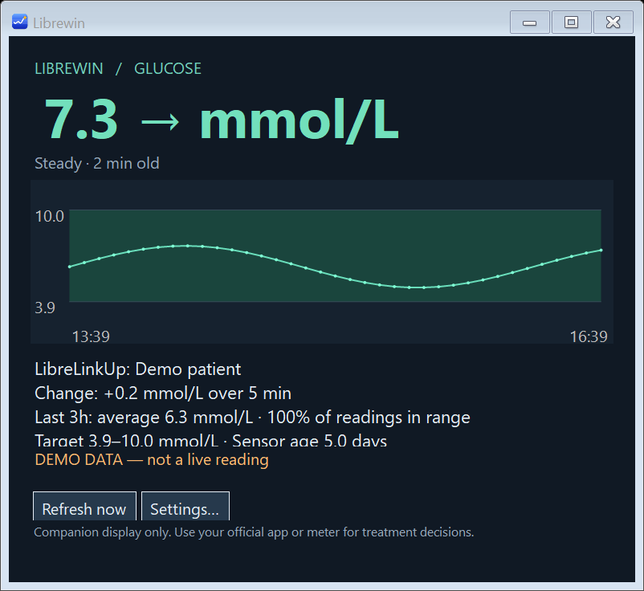

# GlucoGeek for Windows

**Your glucose, beside the clock.**

GlucoGeek is a small Windows app that displays readings from **LibreLinkUp** or **Dexcom G7**. A coloured arrow beside the Windows clock shows your glucose trend. Click it to see your latest reading and a three-hour chart.

**[Download the Windows installer](https://github.com/whistle4it/GlucoGeek-Windows/releases/latest)** · [Report a problem](https://github.com/whistle4it/GlucoGeek-Windows/issues)

> **Public beta preparation:** GlucoGeek is free software under the MIT licence. Downloads remain restricted until the maintainer makes this repository public. It is an unofficial companion display; use your official app or meter for treatment decisions.

*Example with made-up readings, shown in mmol/L. You can also choose mg/dL. Sensor age is shown for LibreLinkUp when available; it is not available for Dexcom.*

GlucoGeek was previously called Librewin. The installer upgrades the same app and keeps your saved settings. The separate [GlucoGeek for macOS](https://github.com/whistle4it/GlucoGeek-macOS) repository may require additional access.

## What you need

- A PC running **Windows 10 or Windows 11, 64-bit (x64)**.
- An internet connection.
- A LibreLinkUp follower account, or the Dexcom account used by the person wearing a G7 sensor, with Share enabled.

The installer includes everything needed to run GlucoGeek. You do not need to install .NET separately or use a command line.

## Install GlucoGeek

1. Open the **[download page](https://github.com/whistle4it/GlucoGeek-Windows/releases/latest)**.
2. Under **Assets**, click the file whose name ends in **`Setup-x64.exe`**. For version 0.4.1, this is `GlucoGeek-v0.4.1-Setup-x64.exe`. Choose this installer; the “Source code” files are for developers.
3. When the download finishes, open the file from your browser's downloads list or your **Downloads** folder.
4. Follow the installer. Choose **Start GlucoGeek when I sign in to Windows** if you want it to open automatically. You can also choose to add a desktop shortcut.
5. Launch **GlucoGeek** from the installer's finish page or the Windows **Start** menu.
6. Open **Settings…** and follow the instructions for your glucose source below.

The app installs for your Windows account without needing administrator access. The installer is currently unsigned, so Windows may show an “unknown publisher” warning. Download only from this repository's release page. If your PC blocks installation, check with the person who manages it.

## Connect your glucose account

### LibreLinkUp

1. Choose **LibreLinkUp** under **Glucose source**.
2. Enter the email address and password for your **LibreLinkUp follower account**. This is the account you use to see shared readings in LibreLinkUp.
3. If you follow more than one person, enter the person's full name exactly as it appears in LibreLinkUp, in **Exact patient name**.
4. Choose your **Display units**: **mmol/L**, **mg/dL**, or **Automatic**.
5. Leave **API version**, **API product** and **API User-Agent** at their existing values unless you are troubleshooting with the developer.
6. Click **Save & connect**.

The sensor wearer's phone must continue uploading readings for GlucoGeek to receive them.

### Dexcom G7

1. On the sensor wearer's phone, open the official **Dexcom G7** app and enable **Connections → Share**. Complete the Share setup and keep the phone uploading readings.
2. In GlucoGeek, choose **Dexcom G7** under **Glucose source**.
3. Enter the **sensor wearer's Dexcom username and password**. A Dexcom Follow account will not work here.
4. Select the region for that Dexcom account:
   - **Outside US** for the UK, Europe and other accounts outside the US and Japan.
   - **US** for a US account.
   - **Japan** for a Japanese account.
5. Choose your **Display units**. Select **mmol/L** if that is what you normally use. For Dexcom, **Automatic** displays **mg/dL**.
6. Review the **Low bound** and **High bound**. These set the colours and target range in GlucoGeek only. They are entered in **mg/dL**, even if you display mmol/L, and do not change your G7 alerts.
7. Click **Save & connect**.

GlucoGeek receives readings over the internet through Dexcom Share; it does not connect directly to the sensor.

## Use the app day to day

The **system tray** is the area beside the clock at the bottom of your Windows screen.

| Icon | What you see | What it means |
| :---: | --- | --- |
|  | Green arrow | Your reading is within the displayed target range. |
|  | Red arrow | Your reading is below the displayed target range. |
|  | Amber arrow | Your reading is above the displayed target range. |
|  | Upward arrow | Glucose is rising. |
|  | Sideways arrow | Glucose is steady. |
|  | Downward arrow | Glucose is falling. |
|  | Grey clock | The last reading is more than 11 minutes old. Check its timestamp. |
|  | Grey exclamation mark | The latest refresh failed. Open the app for details. |
|  | Question mark | A reading or trend is not available. |

*These are the actual app icons, enlarged for clarity. Read the colour and direction together: for example, a red upward arrow means glucose is low but rising. Diagonal arrows show a gentler rise or fall; double arrows show a faster rise or fall.*

- **Hover over the tray icon** to see the exact glucose reading and units.
- **Click the tray icon** to open the chart, reading age and recent statistics.
- **Right-click the tray icon** to refresh, open settings or choose **Quit GlucoGeek**.
- Closing the chart window keeps GlucoGeek running in the tray.
- In **Settings…**, you can change units, refresh frequency and **Start with Windows**.

**Can't see the icon?** Click the small **^** beside the Windows clock to check hidden icons. You can drag GlucoGeek's icon beside the clock, or use Windows taskbar settings to choose which tray icons are visible.

## Update or uninstall

**To update:** right-click the tray icon and choose **Quit GlucoGeek**, then download and run the latest installer. Your saved account details and preferences are kept. Open GlucoGeek from the Start menu afterward.

**To uninstall:** open Windows **Settings → Apps**, find **GlucoGeek** in **Installed apps** (Windows 11) or **Apps & features** (Windows 10), and choose **Uninstall**. Saved account settings are retained for a later reinstall. To remove saved credentials for a source, use **Sign out of this source** in GlucoGeek before uninstalling.

If you previously used a ZIP download, use the installer for future updates and launch the app from the Start menu. Older extracted folders are not automatically removed.

## Need help?

| Problem | What to try |
| --- | --- |
| You cannot open the download page | Check the repository address. During private beta preparation, sign in with an account that has repository access. |
| No readings appear | Check your internet connection and confirm that readings are updating in the official phone app. Check the account and source in Settings. |
| Dexcom sign-in fails | Use the wearer's account, check the region, and confirm that Share is enabled in the G7 app. After correcting details, click **Save & connect** again. |
| The wrong person's readings appear | Check **Exact patient name** against LibreLinkUp, then reconnect. |
| The numbers look unfamiliar | Check whether your usual units are **mmol/L** or **mg/dL** and select them in Settings. |
| The app says it is already running | Look beside the clock and in hidden tray icons, then click its icon. |
| Windows opens an older copy | Quit it, run the latest installer, and open GlucoGeek from the Start menu. Remove any old shortcuts you created yourself. |

If you still need help, **[report a problem](https://github.com/whistle4it/GlucoGeek-Windows/issues)**. Include your app version and what happened. Do not post passwords, account details or screenshots containing personal readings.

## Privacy and important information

Passwords are protected for your Windows user account. Readings and sign-in session tokens are kept in memory rather than saved to disk. Account names and display preferences are saved locally.

GlucoGeek is an unofficial companion display, not a medical device, and is not affiliated with Abbott or Dexcom. Readings can be delayed if the sensor wearer's phone has not uploaded them. **Use your official app or meter for treatment decisions.** GlucoGeek does not provide alarms, insulin advice or treatment calculations.

## About the project

GlucoGeek is the Windows port of **[GlucoGeek for macOS](https://github.com/whistle4it/GlucoGeek-macOS)** and uses its original app icon.

Looking for build instructions, technical details or source attribution? See the **[developer guide](docs/DEVELOPER.md)**.

## Licence and contributions

GlucoGeek for Windows is free and open source under the [MIT licence](LICENSE). See [third-party notices](THIRD_PARTY_NOTICES.md) for source, icon and runtime attribution. Bug reports and contributions are welcome; please read [Contributing](CONTRIBUTING.md) and [Security](SECURITY.md) before sharing diagnostic information.
